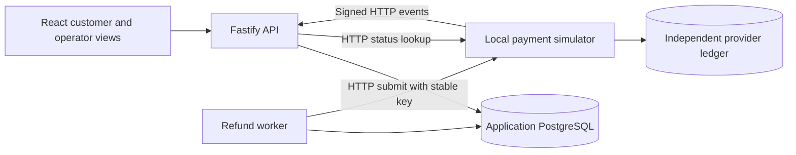

# Architecture and transaction boundaries

The application and simulator are separate processes, databases, credentials,
and volumes. The API and worker receive the provider HTTP credential, never its
SQL connection or administrative controls. Verification drivers can inspect both
databases as independent oracles. They do not replace the application's HTTP
provider boundary.

## Request and decision

Amounts are integers in minor units. Order lines allocate their stored net value
across purchased units, preserving the exact line total when division leaves a
remainder. A partial request claims particular units under the order lock. A
unique active-claim index prevents competing requests from reserving the same
unit. The server derives customer, merchant, eligibility, and amount from its
session and persisted order. The client supplies quantities and a reason.

Approval, receipt, and inspection check role, merchant, expected state, and the
current row under lock. Each decision commits its state and actor/reason audit
together. Rejection or inspection failure releases active claims atomically.
Successful refunds permanently consume the purchased units.

## Financial operation

Finance confirmation locks the order and return, verifies the reserved units and
capture capacity, then atomically creates the operation, outbox job, and audit.
Each return has one operation. Its amount, merchant, payment reference, currency,
key, and fingerprint remain stable. Every operation, including unknown and failed,
counts against reserved capture capacity. The database prevents a replacement
operation from bypassing an uncertain result.

The worker claims a due job with a ten-second lease and unique token, then commits
before HTTP. Completion locks in order: order, return, operation, job. It checks
the token again and atomically stores receipt, operation status, attempt outcome,
job acknowledgement, and audit. Success also closes the return and consumes its
units. A stale worker cannot overwrite a later owner or a completed refund.

No SQL transaction spans provider HTTP. A crash after the provider ledger commit
leaves the original job recoverable. Reclaiming it uses the same key and payload.
The simulator returns the stored receipt and keeps one ledger entry.

## Unknown outcomes and events

A lost, timed-out, invalid, or mismatched response is unknown. Only the simulator's
explicit pre-write rejection can retry automatically. Finance lookup uses the
original key outside SQL, then locks and rechecks the operation before applying
the result. A confirmed missing key permits requeuing that existing operation.

The event receiver authenticates the exact raw bytes and a recent delivery
timestamp. It matches the operation identity and confirms terminal observations
through provider lookup. Unique event receipt, financial effects, and audit
commit together. Receipt insertion rolls back if the business write fails.
Duplicates add no second financial effect. Processing cannot regress success;
contradictory terminal observations reconcile against provider truth.

These boundaries are covered by real PostgreSQL races, independent ledger checks,
actual process crashes/restarts, and browser journeys. The simulator's contract
is documented separately; a production provider would need its own adapter and
operational guarantees.
