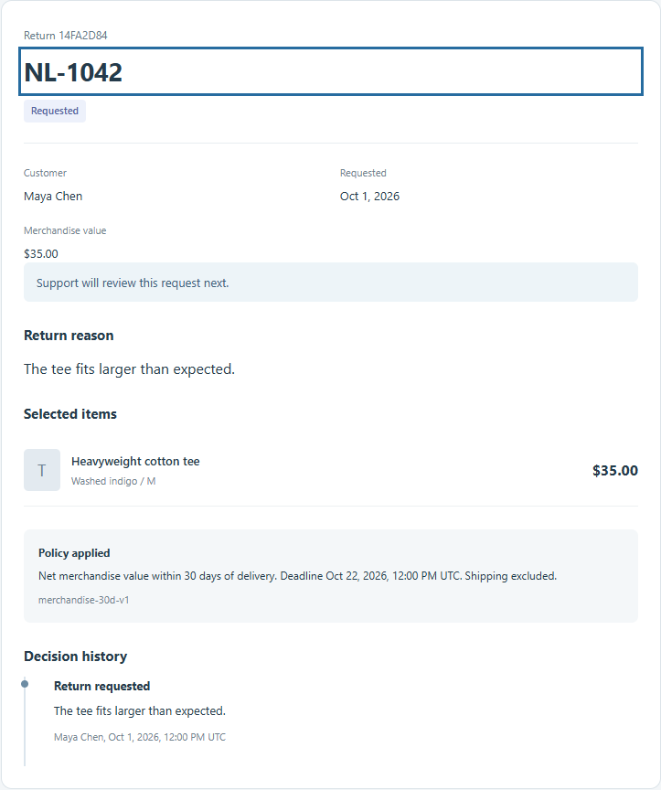
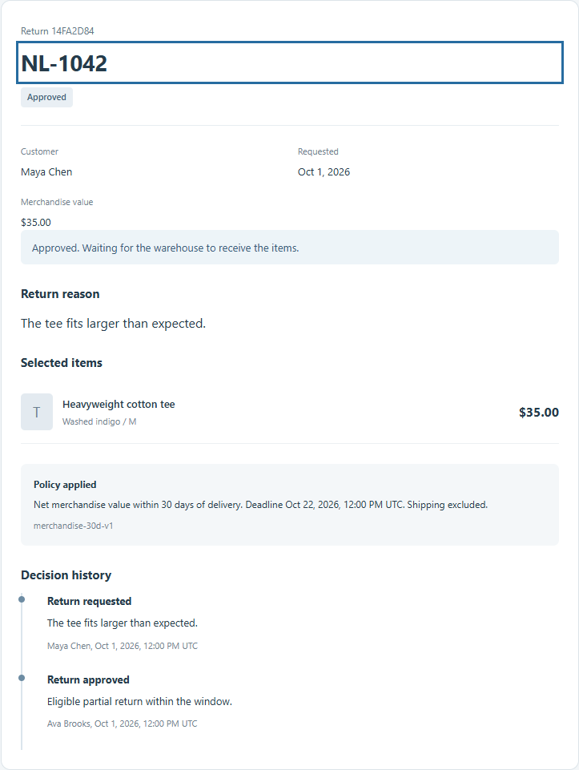
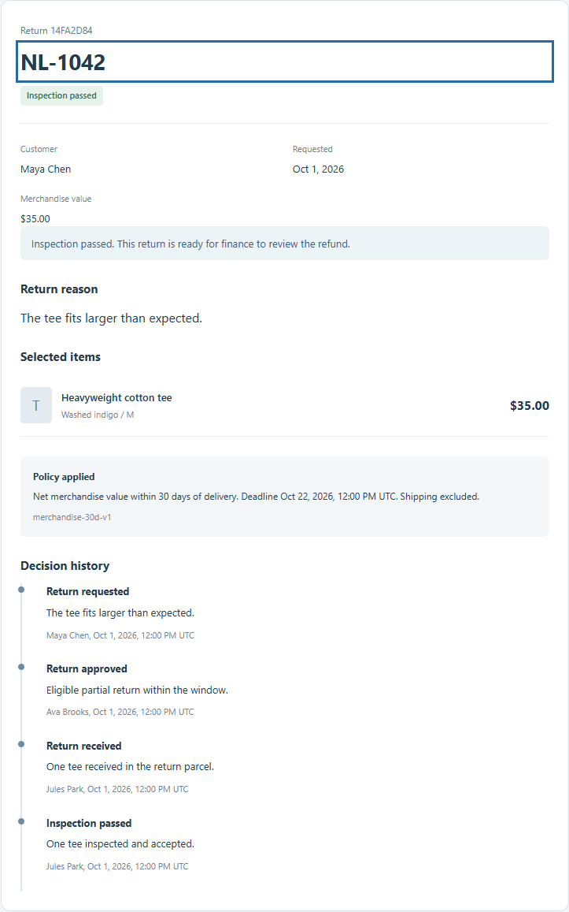
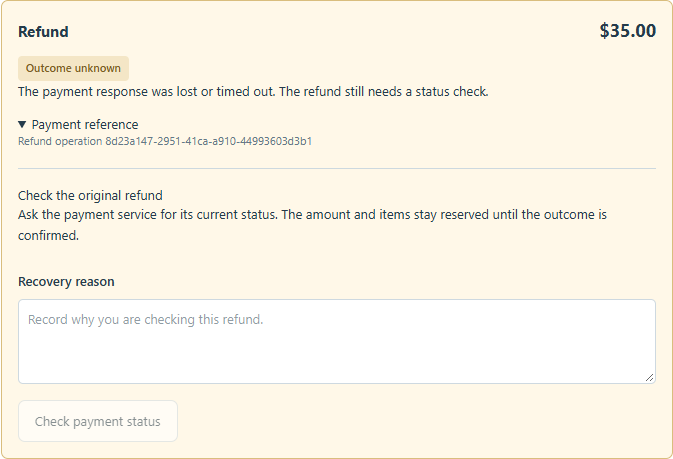
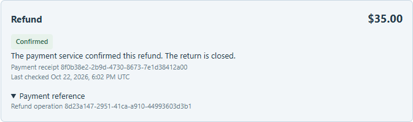
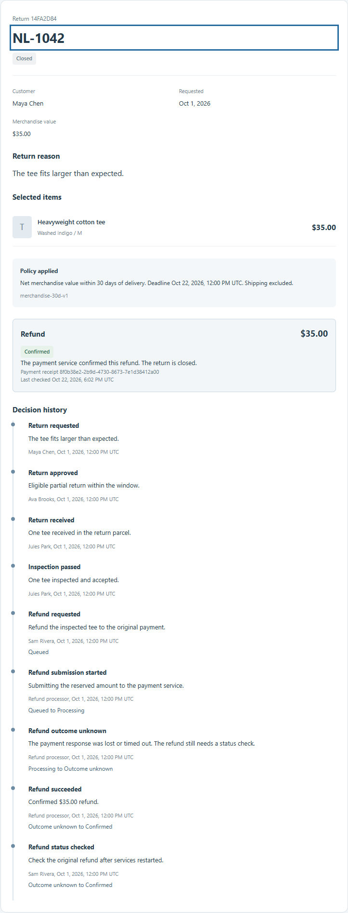
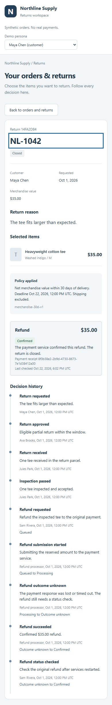
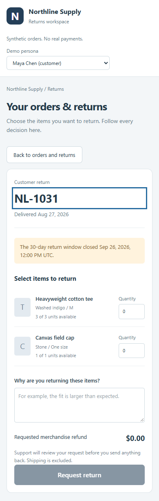
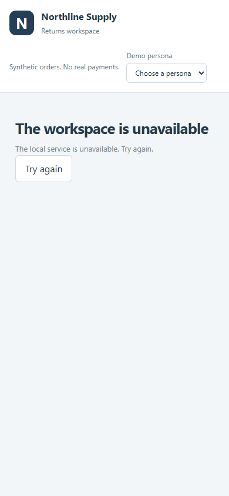

# A partial return, step by step

Follow one $35 tee from Maya's order through support, warehouse inspection, and
refund recovery. Each screenshot shows the real local application. All people,
orders, and payments are fictional.

## 1. Maya requests one item

Maya returns one tee from a three-tee order. The server calculates $35 and reserves
only that unit while support reviews the request.

## 2. Ava approves the return

Support checks eligibility and records a reason. The return now waits for the
warehouse to receive the parcel.

## 3. Jules receives and inspects the tee

The warehouse records receipt and passing inspection separately. The accepted
item is ready for finance to review its refund.

## 4. Sam sees an uncertain payment

Finance confirms $35. The simulator stores success but drops its HTTP response.
The app shows **Outcome unknown** and keeps the original operation and amount
reserved. A timeout cannot establish whether money was refunded.

## 5. Sam checks the original payment

After the actual API, worker, and simulator restart, finance checks the original
key with a recovery reason. **Confirmed** refers to the same refund. Independent
assertions verify one $35 ledger entry and one success audit after three signed
copies of a late processing event.

## 6. Maya sees the result

Customer history includes the confirmed refund and recovery explanation. The
journey also checks that two of the three tees remain available for another return.

## Narrow layouts and errors

At 390 pixels, the detail panel replaces the queue and its back button restores
focus. The expired order disables return controls and explains the 30-day window.
An actual API outage shows a retry action; restarting the API restores the queue.

See the narrow-layout screenshots

## Reproduce and inspect

Run `pnpm browser:install`, then `pnpm test:e2e`. Both journeys use fresh paired
databases and the real UI, API, worker, and simulator. Their screenshots and
financial assertions replace `.local/e2e-last-success`. The [handoff](../HANDOFF.md)
explains capture filenames, retention, and verified cleanup.

The [capture record](evidence/screenshot-capture.json) identifies the run, source,
image hashes, dimensions, and test results. Its [financial evidence](evidence/screenshot-financial.json)
contains the matching return, operation, provider ledger, and audit count. Read
the [case study](case-study.md) for transaction boundaries and simulator limits.
